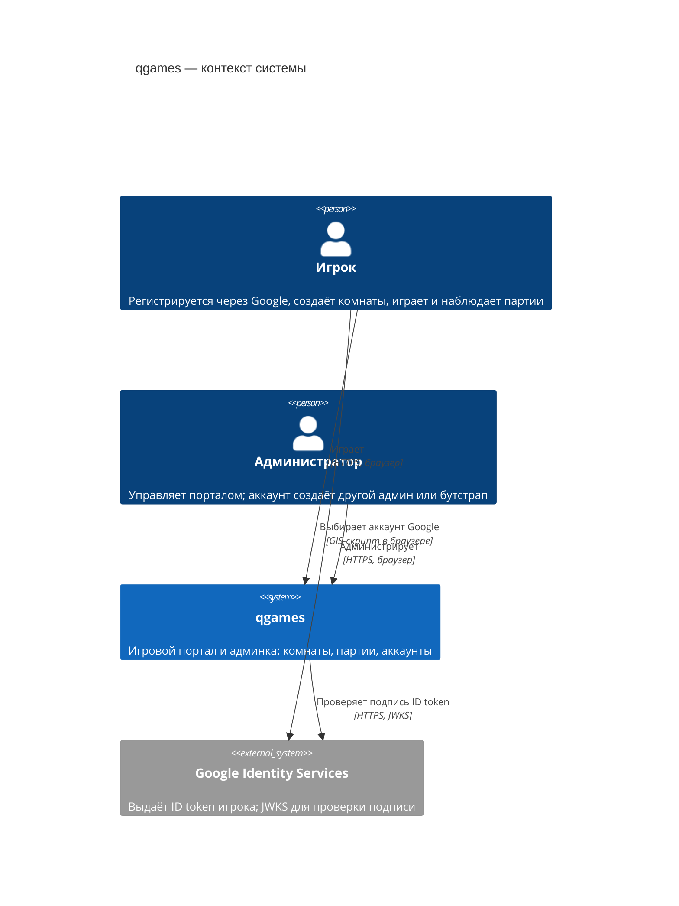

# C4 · Уровень 1 — контекст системы

qgames — игровой портал пошаговых настольных игр (сейчас «игра в ничто» для проверки движка и шашки, далее Каркассон). Игроки создают комнаты под игру, заходят в них по ссылке и играют партии в реальном времени. Администраторы управляют порталом через отдельную админку.

| Элемент | Роль | Подробнее |
|---|---|---|
| Игрок | Пользователь портала (`<домен>`) | [player-accounts](../security/player-accounts.md) |
| Администратор | Пользователь админки (`admin.<домен>`), ролей нет — все админы равны | [admin-separation](../security/admin-separation.md) |
| qgames | Три контейнера за одним nginx — см. [уровень 2](2-containers.md) | [backend-architecture](../backend/backend-architecture.md) |
| Google Identity Services | Единственный внешний провайдер личности (позже VK и др.) | [player-accounts](../security/player-accounts.md) |

Других внешних систем нет: почту портал не шлёт, платежей нет.
