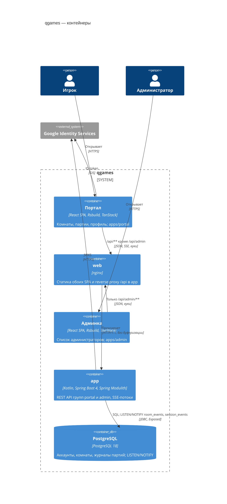

# C4 · Уровень 2 — контейнеры

| Контейнер | Ответственность | Код | Решения |
|---|---|---|---|
| Портал | CSR SPA игрока: вход, профиль, каталог, комнаты, доска партии. Правил игр не знает | `frontend/apps/portal`, `packages/*` | [frontend-apps](../frontend/frontend-apps.md), [frontend-game-logic](../frontend/frontend-game-logic.md) |
| Админка | CSR SPA администратора, ходит только в группу `admin` | `frontend/apps/admin` | [admin-separation](../security/admin-separation.md) |
| web | Один образ nginx: по server-блоку на приложение, статика и proxy в app того же origin | `frontend/docker/nginx` | [reverse-proxy](../system/reverse-proxy.md) |
| app | Модульный монолит, один процесс на порту 8080, один инстанс | `backend/*` | [backend-architecture](../backend/backend-architecture.md), [scaling](../backend/scaling.md) |
| PostgreSQL | Одна БД `qgames`, одна роль; рассылка событий потокам | миграции в `backend/<m>/<m>` | [data-access](../backend/data-access.md), [realtime-transport](../game/realtime-transport.md) |

## Связи

- **Same-origin.** Каждый SPA ходит в API своего хоста: портал (`<домен>`) — в `/api/**`, админка (`admin.<домен>`) — только в `/api/admin/**`. Чужая группа на хосте отвечает 404. CORS нет. Локально вместо nginx — dev-proxy Rsbuild (`pnpm dev`) → [session-tokens](../security/session-tokens.md).
- **REST + SSE.** Действия — REST/JSON, события комнаты и партии — SSE. Ошибки — `ProblemDetail` с машиночитаемым `code` → [api-contract](../contract/api-contract.md), [realtime-transport](../game/realtime-transport.md).
- **Контракт — OpenAPI** двух групп (`/v3/api-docs/portal`, `/v3/api-docs/admin`). Фронт генерирует по ним клиент Orval → [api-client-generation](../contract/api-client-generation.md).
- **Сессия — HttpOnly-куки**, их ставит app. Фронт токенов не видит → [jwt-and-refresh](../security/jwt-and-refresh.md).

Дальше: компоненты [app](3-backend.md) и [фронта](3-frontend.md), [развёртывание](deployment.md).
