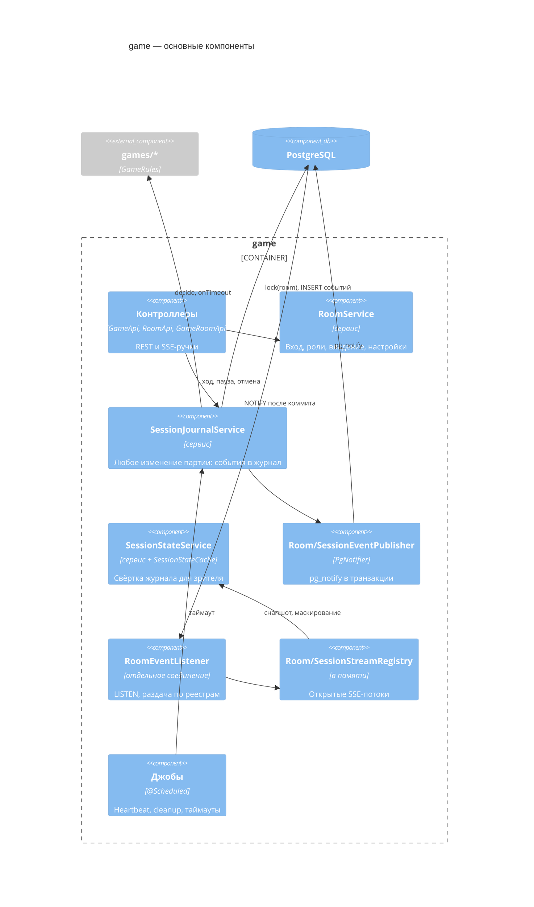

# C4 · Уровень 3 — модуль game: каталог, комнаты, партии

Решения: [game-catalog](../game/game-catalog.md), [room-lifecycle](../game/room-lifecycle.md), [room-presence](../game/room-presence.md), [session-state](../game/session-state.md), [realtime-transport](../game/realtime-transport.md). Таблицы — [erd/game](../erd/game.md).

## Каталог игр

- Игры объявлены в таблице `game` DML-миграциями. Набор кодов совпадает с enum `GameCode`. `GameCatalogVerifier` при старте проверяет совпадение и наличие модуля правил (кроме `NOT_PUBLISHED`), при расхождении приложение не стартует.
- Статусы публикации (наружу не выходят):

  | Статус | В `GET /api/games` | Игра, комнаты, партии | Модуль правил |
  |---|---|---|---|
  | `PUBLISHED` | да | работают | обязателен |
  | `HIDDEN` | нет | работают (по прямой ссылке) | обязателен |
  | `NOT_PUBLISHED` | нет | 404 `GAME_NOT_FOUND`, комнаты удаляет `NotPublishedGameCleanupJob` | может отсутствовать |

- Доступность игры (`GameService.checkAccessible`) проверяется в каждой операции с комнатой, под её блокировкой.

## Комнаты

- **Публичные, без поиска:** вход по ссылке для любого авторизованного пользователя.
- **Создание:** комната создаётся пустой (`empty_since = now`, `ownerId = null`) с настройками игры по умолчанию ([room-settings](../game/room-settings.md)). Первый подключившийся к потоку становится игроком и владельцем.
- **Вход** (открытие SSE-потока, [dynamic/room-stream](dynamic/room-stream.md)): игрок идущей партии возвращается на место. Иначе он становится игроком, если партия не идёт и есть место, или наблюдателем, если наблюдателей меньше `settings.room.maxSpectators` (иначе 409 `NO_SPECTATOR_SEAT`, поток не открывается). Повторный вход ничего не меняет.
- **Выход** — закрытие последнего потока пользователя, участник удаляется сразу. Исключение — игроки идущей партии: они остаются участниками с `left_at` (`leaving = true`) до конца партии.
- **Владение:** если владелец ушёл, владельцем в той же транзакции становится случайный присутствующий игрок, а при отсутствии игроков — случайный наблюдатель. Если присутствующих нет, `ownerId = null` и владельцем станет первый вошедший. Владелец может передать владение сам: `PUT /api/rooms/{id}/owner` (409 `NEW_OWNER_NOT_PRESENT`). Только владелец стартует, ставит на паузу, продолжает и отменяет партию.
- **Роли и правила игры** (simple/advanced) меняются только между партиями (WAITING), лимит наблюдателей — в любой момент. В наблюдатели — только при свободном месте (409 `NO_SPECTATOR_SEAT`). Партия хранит снапшот advanced.
- **Автоудаление:** комнату без присутствующих дольше 30m удаляет `EmptyRoomCleanupJob`. Отсутствующие игроки партии комнату не держат.
- **Конкурентность:** каждая мутация комнаты, участников и партии выполняется под `RoomRepository.lockById` (`SELECT … FOR UPDATE` строки `room`). Смена ника тоже: `profile-changed` публикуется под блокировкой каждой комнаты (в своей транзакции) — seq потока комнаты растёт только под ней.

## Партии (сессии комнаты)

- **Seed партии** — случайный (`SecureRandom`). На локальном стенде (`qgames.game.session.seed-header-enabled`, профиль local) старт берёт seed из заголовка `X-Qgames-Seed`: так e2e-сценарии воспроизводят цвета и раздачи. Заголовок не входит в контракт и в проде игнорируется → [e2e-testing](../frontend/e2e-testing.md).
- Таблицы общие для всех игр: `room_session` (статус, seed, `last_seq`, снапшот настроек, `move_deadline`), `room_session_player` (места), `room_session_event` (журнал). **Состояние не хранится:** это свёртка журнала.
- **Любое изменение** (старт, ход, таймаут, пауза, продолжение, конец, отмена) проходит через `SessionJournalService` под `lock(room)`: полное состояние на `last_seq` → события → INSERT с seq от `last_seq + 1` → обновление `last_seq`, статуса, `move_deadline` → `pg_notify`. Поток — [dynamic/move](dynamic/move.md).
- **Мутации партии отвечают 204**, результат приходит событиями потока партии. Старт возвращает комнату. В ответе комнаты партия краткая — `session {id, status}`.
- **Ход** — одна ручка на все игры: `POST /api/games/{gameCode}/rooms/{roomId}/moves`, тело — конверт `{type, data}`. Ход проверяется по текущему состоянию без версии, недопустимый ход — 422 `MOVE_REJECTED` с `reason`. Схемы `data` игр публикуются в components (`MoveDataSchemas.CLASSES`).
- **Кеш состояний** `SessionStateCache` (Caffeine): `(sessionId, viewerKey) → (seq, state)`, дочитываются только новые события. Инвалидация не нужна: журнал только дописывается. 2000 записей, `expire-after-access` 5m — под heap 256 МБ.
- **Часы** — единственный вид таймера (`{baseSeconds, bonusType, bonusSeconds}`, `null` — без таймера, [time-control](../game/time-control.md)): инкремент Фишера (simple-правила) или задержка (только advanced). Пауза считается по меткам времени и времени не добавляет. Часы переключаются только при смене очереди — изменении `state.turns` (игрок или раунд, в том числе ход снова у того же игрока). `MoveTimeoutJob` раз в секунду обрабатывает истёкшие `move_deadline`; ход, пришедший после дедлайна, но раньше джоба, принимается.
- **Пауза** — часть таймера. В игре без таймера пауза отвечает 409 `SESSION_NOT_PAUSABLE`. На паузе ход — 409 `SESSION_PAUSED`. `resume` сдвигает дедлайн на длительность паузы.

## Открытые вопросы

- Решить при управлении каталогом в админке: перевод в `PUBLISHED`/`HIDDEN` только при наличии модуля правил (проверка в ручке), судьба `NotPublishedGameCleanupJob`.
- Решить при реализации: приватные комнаты и поиск.
