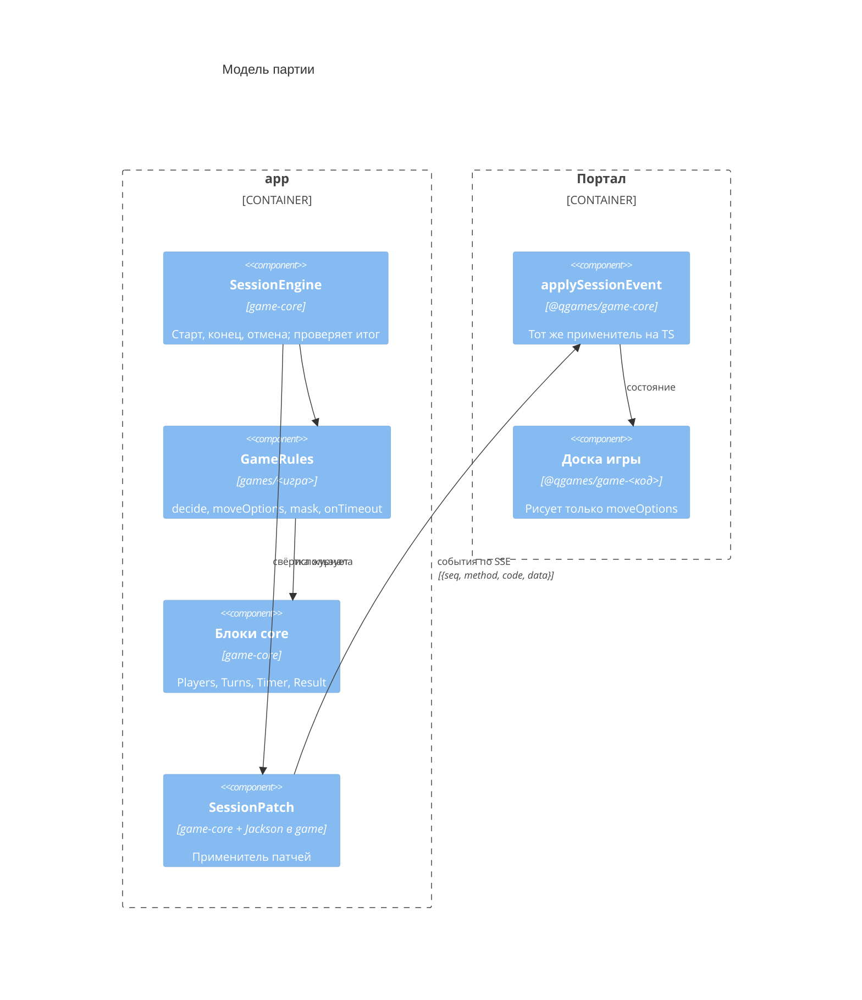

# C4 · Уровень 3 — модель игры (`games/*` и общий применитель патчей)

Одна модель на бэкенде и фронте: сервер порождает события-патчи, обе стороны применяют их одним общим применителем. Решения: [session-state](../game/session-state.md), [game-rules-modules](../backend/game-rules-modules.md), [frontend-game-logic](../frontend/frontend-game-logic.md). Чек-лист новой игры — `backend/games/CLAUDE.md`.

## Событие — патч документа

Документ партии — `{status, meta, state}`. Событие — `SessionEvent(code, method, path, value)`:

| Поле | Смысл |
|---|---|
| `code` | Говорящее имя произошедшего (`player-passed`, `turn-changed`). Нужно только для журнала, логов и повтора, состояние по нему не меняется |
| `method` | `PUT` — заменить или создать (по ненайденному `{id}` — добавить в конец); `PATCH` — неглубокое слияние, `null` — это значение; `DELETE` — удалить поле или элемент; `INFO` — без изменений, только данные для журнала |
| `path` | Сегменты: строка — ключ объекта, `{id}` — элемент массива по id (у элементов адресуемых массивов `id` обязателен) |

Одно событие — одна операция. Действие, меняющее несколько мест, порождает несколько событий, каждое со своим seq. Неподходящий путь — `SessionPatchException`: на сервере это баг, на фронте — переподключение.

## `GameRules` — что задаёт игра

- `start` — начальное состояние. `SessionEngine` превращает его в первое событие `session-started` = `PUT [] {status, meta: {game: {code, rules}, moveRules}, state}`;
- `decide(state, settings, playerId, move)` → `Rejected(code)` или `Accepted(events)`;
- `moveOptions(state, playerId)` — допустимые действия. Фронт правил не знает и рисует только их;
- `mask(event, viewerKey)` — маскирует `value` для проекций `Full`/`Public`/`Player(id)`. Замаскированное событие доставляется со своим seq. Инвариант «свёртка маскированных = маска полной свёртки» обязателен к тесту;
- `moveRules(settings)` — флаги для подсказок ввода на клиенте (`meta.moveRules`), `onTimeout(state)`;
- настройки игры с границами (`GET /api/games/{gameCode}`), поля игры у игрока (`playerClass`), правила часов (`TimeControlRules`).

Случайность берётся только из seed партии: журнал воспроизводим при переигрывании.

## Блоки core (есть у каждой игры)

| Блок | Форма | Коды |
|---|---|---|
| Игроки | `players: [{id, moveOptions, …поля игры}]`; чужим `moveOptions` маскируются в `[]` | `move-options-changed` |
| Очерёдность | `turns: {currentPlayerId, round, rounds}` | `turn-changed` |
| Часы | `timer: {status, deadline, pausedAt, clocks}` или `null` | `clock-switched`, `timer-stopped`, `game-paused`, `game-resumed` |
| Итог | `result: {outcome: WIN\|DRAW, winnerIds, reason}` или `null`; фронт показывает через `GameOver`, текст `reason` — в пакете игры | `result-set` — один раз, вместе с `session-finished` |
| Сессия | — | `session-started`, `session-finished`, `session-cancelled` |

## Игры

- **«Ничто»** — тестовая игра: ходы `PASS` по очереди, число раундов задаётся в настройках. Таймаут — пропуск хода (`INFO`). Итога нет.
- **Шашки** — варианты правил (русские, международные, английские) задаются настройкой комнаты. `moveOptions` дают только типы действий (`MOVE`, `ACCEPT_DRAW`, `RESIGN`), пути проверяются по флагам `CheckersMoveRules`. Окончания: победа (`NO_PIECES`, `NO_MOVES`, `RESIGN`, `TIMEOUT`) и ничья (`DRAW_AGREED`, `REPETITION`, `ENDGAME_RULE`, `DRAW_RULE`). Цвета распределяются случайно по seed.
- **Каркассон** — модуль появится, когда начнётся работа над правилами.

## Открытые вопросы

- Решить при первой такой игре: хук игры на отсутствие игрока (сейчас партия на отсутствие не реагирует).
- Отдельное приложение для игры с особой нагрузкой (WebSocket) — только по согласованию, с переиспользованием модуля `games/`.
