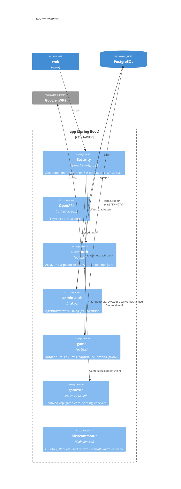

# C4 · Уровень 3 — компоненты app (бэкенд)

Модульный монолит на Spring Modulith: модули с явными границами в одном процессе ([backend-architecture](../backend/backend-architecture.md)).

| Компонент | Ответственность | Пути API | Код |
|---|---|---|---|
| `user-auth` | Аккаунты игроков (неизменяемый логин, ник, аватар), регистрация через Google, вход по Google и паролю, JWT и куки портала | `/api/auth/*`, `/api/users/me/*` | `backend/user-auth/{user-auth,user-auth-api}` |
| `admin-auth` | Администраторы: логин и пароль, без регистрации, JWT и куки админки. Упрощённая копия user-auth | `/api/admin/auth/*`, `/api/admin/admins/*` | `backend/admin-auth/…` |
| `game` | Каталог игр, комнаты, участники, присутствие, партии и их журнал, SSE, таймеры | `/api/games/*`, `/api/rooms/*` | `backend/game/{game,game-api}` → [3-backend-game](3-backend-game.md) |
| `games/*` | Правила игр без Spring и IO: `game-core` (модель и общие блоки), `nothing-game`, `checkers-game` | — | `backend/games/*` → [3-backend-games](3-backend-games.md) |
| `app` | `@SpringBootApplication`, Security, группы OpenAPI, `application.yml`, сводный Liquibase-master, все интеграционные тесты | — | `backend/app` |
| `libs/*` | Инфраструктура без бизнес-логики: `common-exception`, `common-web`, `common-test`, `doc-patch` (применитель событий-патчей) | — | `backend/libs` |

## Границы и связи модулей

- Модуль = `<m>/<m>` (реализация) + `<m>/<m>-api` (публичный контракт: REST-интерфейсы, DTO, события, публичные описания таблиц). Модуль зависит только от `libs/*`, `games/*` и чужих `-api`. Границы проверяет `ModularityTest` → [module-communication](../backend/module-communication.md).
- Сейчас межмодульная связь одна: **game → user-auth-api**. game читает ник и аватар через `UserProfileTable` (join, только чтение) и слушает `UserProfileChanged`, после чего публикует `profile-changed` в комнаты пользователя.
- Слои внутри модуля: контроллер → сервис → фасад-репозиторий → `…ExposedRepository`. DTO только в контроллерах → [backend-layers](../backend/backend-layers.md).

## Security и аутентификация

Устройство цепочек, кук, refresh, бутстрапа админа и профиля игрока — в [3-backend-auth](3-backend-auth.md), потоки входа и refresh — в [dynamic/auth](dynamic/auth.md).

## Фоновые джобы (модуль game)

| Джоб | Интервал | Что делает |
|---|---|---|
| `RoomConnectionHeartbeatJob` | 5 с | ping в SSE-потоки комнат, продление аренды подключений |
| `RoomConnectionCleanupJob` | — | удаляет протухшие подключения, уводит пользователей без подключений |
| `EmptyRoomCleanupJob` | — | удаляет комнаты, пустые дольше `empty-ttl` (30m) |
| `MoveTimeoutJob` | 1 с | обрабатывает истёкшие дедлайны хода по `room_session.move_deadline` |
| `NotPublishedGameCleanupJob` | 1m | отменяет партии и удаляет комнаты игр `NOT_PUBLISHED` |

Все джобы выбирают id без блокировки, затем обрабатывают каждую комнату в своей транзакции под блокировкой комнаты с перепроверкой. У каждого джоба свой флаг `…-enabled` ([scaling](../backend/scaling.md)).

## Состояние в памяти процесса

`RoomStreamRegistry` и `SessionStreamRegistry` (открытые SSE-потоки), `SessionStateCache` (Caffeine, кеш свёрток партий). Больше ничего: счётчики, блокировки и присутствие хранятся в БД → [scaling](../backend/scaling.md).
