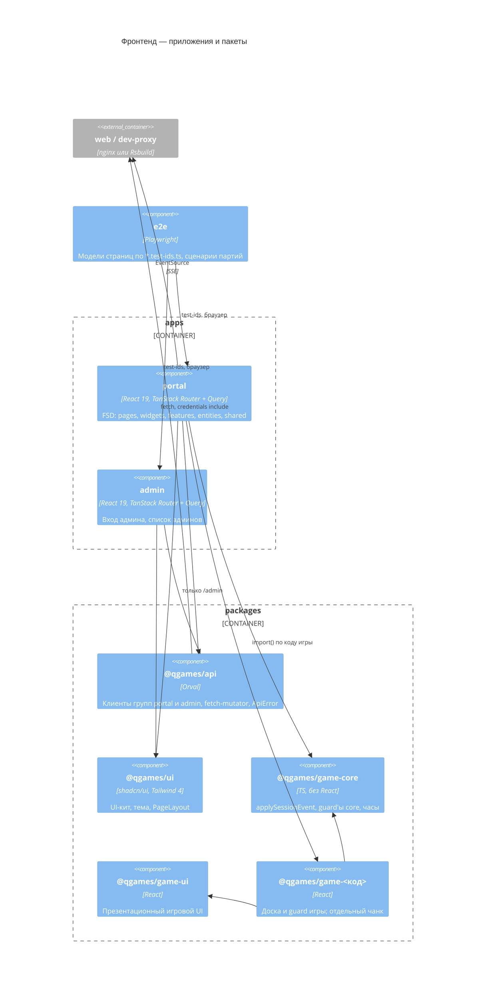

# C4 · Уровень 3 — компоненты фронта

Монорепозиторий pnpm + Turborepo: два CSR-приложения и общие пакеты ([frontend-monorepo](../frontend/frontend-monorepo.md), [frontend-apps](../frontend/frontend-apps.md)). Маршруты и поведение страниц — [3-frontend-portal](3-frontend-portal.md).

| Компонент | Ответственность | Решения |
|---|---|---|
| `apps/portal` | Портал игрока, слои FSD, роуты `src/routes/` | [frontend-architecture](../frontend/frontend-architecture.md) |
| `apps/admin` | Админка, ходит только в группу `admin` | [admin-separation](../security/admin-separation.md) |
| `@qgames/api` | Сгенерированный клиент (Query-хуки, типы, Zod), общий mutator с single-flight refresh, `errorMessage`, `applyFieldErrors` | [api-client-generation](../contract/api-client-generation.md) |
| `@qgames/ui` | Компоненты shadcn, тема (`globals.css`), `ThemeProvider` (сейчас только light) | [ui-kit](../frontend/ui-kit.md) |
| `@qgames/game-core` | Чистые функции партии: применитель патчей, сверка seq, guard'ы core, `activeTimer`, `playerClock` | [frontend-game-logic](../frontend/frontend-game-logic.md) |
| `@qgames/game-ui` | Аватар, список игроков, часы, конец партии. Только props, без запросов и сторов | [frontend-game-logic](../frontend/frontend-game-logic.md) |
| `@qgames/game-<код>` | Модуль игры `{Board, isGameState}`; портал грузит его только динамическим `import()` | [frontend-game-logic](../frontend/frontend-game-logic.md) |
| `e2e` (`@qgames/e2e`) | E2E на Playwright против поднятых стендов: модели по `*.test-ids.ts` компонентов, фикстуры `testPortal`/`testAdmin`, акторы, сценарии партий из JSON | [e2e-testing](../frontend/e2e-testing.md) |
| `@qgames/config` | tsconfig, ESLint (gts + strict + FSD boundaries), Stylelint, Prettier | [linting](../frontend/linting.md) |

## Данные и состояние

- **Серверные данные — только TanStack Query** с ключами из Orval. Копировать их в zustand или `useState` нельзя. zustand хранит только клиентский стейт → [server-state](../frontend/server-state.md).
- **Сессия:** токены в HttpOnly-куках, признак «вошёл» — успешный `GET /api/users/me` (`/api/admin/admins/me`). На 401 `UNAUTHENTICATED` mutator делает один общий refresh и повторяет запрос → [dynamic/auth](dynamic/auth.md).
- **Ошибки:** mutator превращает `ProblemDetail` в `ApiError` (`status`, `code`, `reason`, `fieldErrors`). UI ветвится только по `code`, тексты `detail` не показываются.
- **Формы:** react-hook-form + Zod 4 по сгенерированным схемам, сообщения на русском → [frontend-libraries](../frontend/frontend-libraries.md).

## SSE (только портал)

- Обёртка `apps/portal/src/shared/lib/sse` (`createEventStream`): `EventSource` с `withCredentials`, каждое сообщение проверяется Zod-схемой union событий из components. Закрытый поток (в том числе 401) → `refreshSession()` и переподключение с backoff 1 → 30 с. Гостя обёртка не переподключает.
- URL SSE-ручек собирается через `resolveUrl`: Orval эти ручки не генерирует.
- **Поток комнаты** строит комнату в кеше `['room-stream', roomId]` (`entities/room`: `useRoomEvents`, `applyRoomStreamMessage`): снапшот `{seq, room}` заменяет её, патчи применяются общим `applyPatch` (`@qgames/doc-patch`) строго по seq, документ после патча проверяется схемой `RoomResponse`. Дыра в seq, неприменимый патч или сообщение не по контракту — переоткрытие за снапшотом (backoff как у партии), `room-deleted` закрывает поток → [dynamic/room-stream](dynamic/room-stream.md). `GET` комнаты страница использует только для ошибок: он перечитывается (`invalidateRoom`), когда поток закрыт сервером.
- **Поток партии** хранит состояние в кеше Query под ключом `['session-stream', sessionId]` (`entities/session`). Seq сверяется: повтор отбрасывается, а дыра, сообщение не по контракту, ошибка патча или провал guard'ов закрывают поток и открывают заново за свежим снапшотом. Если статус не `IN_PROGRESS`, поток закрывается без переподключения → [dynamic/move](dynamic/move.md).

## Партия на фронте

Фронт не знает правил игры: применяет патчи общим `applySessionEvent` и рисует только `moveOptions`. Единственное исключение — подсказки ввода пути по флагам `meta.advancedRules`. Состояние проверяется на каждом шаге: общая схема `status`/`meta`, совпадение `meta.game.code` с игрой комнаты, guard core `isCoreState` и guard игровых полей `isGameState`. Любой провал — переподключение. Часы показываются по `activeTimer`, отсчёт идёт с поправкой `clockOffsetMs` по `serverTime` снапшота.
