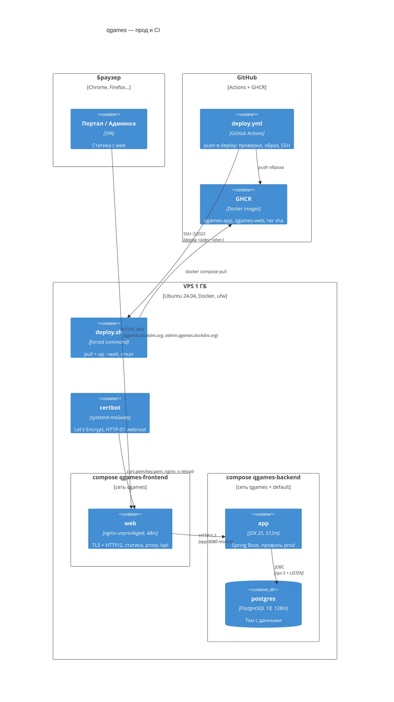

# C4 · Развёртывание

Прод — один VPS на 1 ГБ RAM (`212.119.43.160`, Ubuntu 24.04) под docker compose, без k8s, домен `qgames.duckdns.org`. Решения — [hosting](../system/hosting.md), защита сервера и TLS — [server-hardening](../security/server-hardening.md).

## Узлы и бюджет памяти

Лимит каждого контейнера — `mem_limit` = `memswap_limit` без свопа: при нехватке памяти контейнер убивается OOM-kill, тихой деградации нет. Настройки JVM и PostgreSQL и их обоснование — в [memory-budget](../system/memory-budget.md).

| Что | Лимит | Простой | Пик под нагрузкой |
|---|---|---|---|
| ОС, Docker, sshd (замер на VPS) | — | ~330 МБ вместе с ядром | ~330 МБ |
| nginx (`web`) | 48m | ~15 МБ | ~29 МБ, CPU ~10–13% |
| app | 512m | ~290 МБ | ~430–455 МБ |
| PostgreSQL | 128m | ~30–35 МБ | ~85–95 МБ (часть — вытесняемый кеш страниц) |
| Итого (RAM 961 МБ) | 688 МБ лимитов + ОС | ~670 МБ | ~910 МБ |

Запас под пиковой нагрузкой — ~50 МБ RAM; процессы хоста при нехватке уходят в swap 1 ГБ, контейнеры — нет (BACKLOG «Память VPS»).

Нагрузка замера (локальный стенд, через nginx портала по HTTP/1.1 без TLS, 5 минут; с TLS и HTTP/2 не перемерялся — [reverse-proxy](../system/reverse-proxy.md)): 45 комнат по 2 игрока и 2 наблюдателя, у каждого потоки комнаты и партии (360 SSE), ходы без остановки — ~190 ходов/с, ~4400 SSE-кадров/с. OOM-kill не было. Было 2 ответа 504 от nginx (BACKLOG «Редкие 504»).

## Сеть и proxy

- Наружу открыт только `web`: 443 (TLS, HTTP/2) и 80 (редирект на HTTPS, `/healthz` для healthcheck). Один образ nginx обслуживает два server-блока на одном порту, различаемых по `server_name`: портал и админку. Сертификат на оба имени — том `/etc/nginx/certs`, чужое имя получает обрыв TLS-рукопожатия. Портал проксирует `/api/` кроме `/api/admin/` (на него 404), админка — только `/api/admin/`. В проде upstream — `app:8080` с `resolve` через DNS Docker (сеть `qgames`); локально — только IPv4-адрес `host.docker.internal`: по IPv6 подключение падает с 502. На :80 ещё отдаётся `/.well-known/acme-challenge/` для certbot.
- ufw: входящие только 52022 (SSH), 80, 443; postgres и app портов наружу не публикуют.
- **SSE через proxy:** app отдаёт `X-Accel-Buffering: no`, у nginx `proxy_buffering off`, `proxy_read_timeout 60s` (длиннее ping потоков в 5 с), HTTP/1.1 с пустым `Connection`.
- Заголовки безопасности и CSP ставит nginx на всех ответах, включая API → [reverse-proxy](../system/reverse-proxy.md).
- Swagger и OpenAPI в проде выключены профилем `prod` (ручки отвечают 404). На стенде то же проверяется `API_DOCS_ENABLED=false docker compose up -d --wait app`.

## Локальный стенд

| Что | Где | Как поднять |
|---|---|---|
| app + postgres | `backend/docker-compose.yml`, профиль `local` | `docker compose up --build -d --wait` |
| web (оба SPA) | `frontend/docker-compose.yml`, `API_UPSTREAM` = `host.docker.internal:8080` | `docker compose up --build -d --wait` → `https://<LOCAL_DOMAIN>`, `https://admin.<LOCAL_DOMAIN>` |
| dev-режим фронта | Rsbuild dev-server с HTTPS (`frontend/packages/config/local-https`) + `server.proxy` | `pnpm dev` → те же имена с портами :3000 и :3001 |

`LOCAL_DOMAIN` — `.env` корня фронта (по умолчанию `local.qgames.duckdns.org`), оба имени — в `hosts` на 127.0.0.1, сертификат mkcert — `frontend/docker/certs/` (для nginx и dev-сервера). Поддомены `duckdns.org` — один сайт, как в проде, и Google OAuth принимает их как origin. Настройка — README фронтенда.

Профиль `local` добавляет первого админа `admin`/`admin` и тестовых игроков `qwe3qwe1…10` с паролем `qwe3qwe3`. Переменные `PUBLIC_*` фронта вшиваются в сборку из `apps/<app>/.env`.
