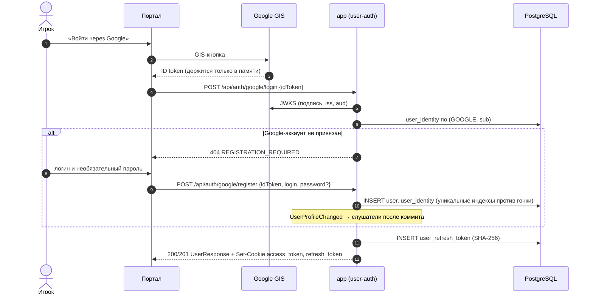
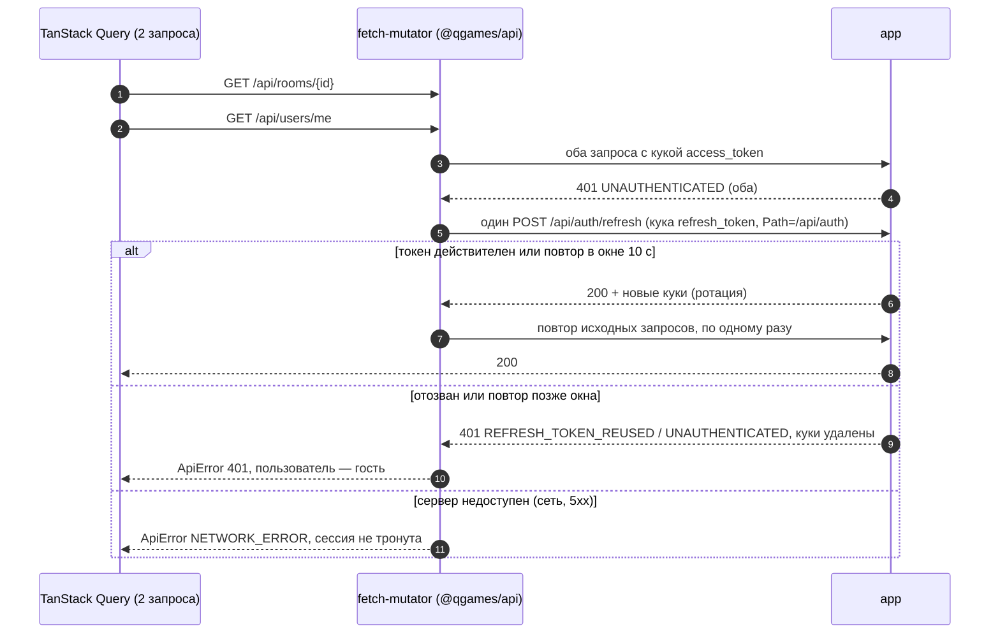

# C4 · Dynamic — вход и обновление сессии

Устройство — [3-backend-auth](../3-backend-auth.md). Решения: [session-tokens](../../security/session-tokens.md), [jwt-and-refresh](../../security/jwt-and-refresh.md), [player-accounts](../../security/player-accounts.md).

## Регистрация и вход через Google

Ошибки регистрации: 409 `LOGIN_TAKEN`, 409 `ACCOUNT_ALREADY_EXISTS`, 401 `INVALID_GOOGLE_TOKEN`. Вход по паролю — `POST /api/auth/login {login, password}`, ответ такой же.

## Протухший access-токен → single-flight refresh

- Обновление общее на все запросы вкладки (single-flight). Параллельные вкладки обновляются одной кукой — их спасает окно терпимости 10 с на сервере.
- Другие 401 (например, `INVALID_GOOGLE_TOKEN`) сессию не трогают. Запросы `{authPath}/*` не повторяются.
- Админка устроена так же, отличается префикс: `/api/admin/auth/*`, куки `admin_*`, access 5 мин, refresh 15 мин скользящий.
- SSE-обёртка не знает статуса ответа `EventSource`, поэтому вызывает `refreshSession()` перед каждой попыткой переподключения. Окончательно поток закрывается только при исходе `guest`, а при `unavailable` переподключение продолжается.
