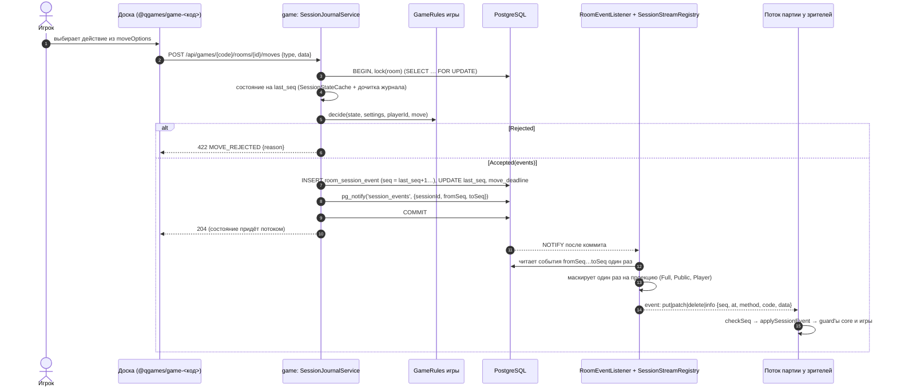

# C4 · Dynamic — ход и поток партии

Решения: [session-state](../../game/session-state.md), [realtime-transport](../../game/realtime-transport.md), [frontend-game-logic](../../frontend/frontend-game-logic.md). Модель событий — [3-backend-games](../3-backend-games.md).

## Поток партии

`GET /api/games/{gameCode}/rooms/{roomId}/sessions/{sessionId}/events` (участник комнаты, в том числе отсутствующий игрок партии; аренды нет). `sessionId` чужой комнаты — 404 `SESSION_NOT_FOUND`, ошибки до старта потока — обычный `ProblemDetail`.

- Первый кадр — `snapshot` без обёртки: `{seq, status, serverTime, meta, state}`, где `state` — свёртка маскированных событий зрителя. Подписчик регистрируется до снапшота. События с `seq ≤ N` снапшота отбрасываются, пришедшие раньше снапшота копятся. Маркер здесь не нужен.
- Seq монотонный, замаскированные события тоже доставляются, поэтому дыра в seq означает реальную потерю: фронт переподключается за свежим снапшотом.
- `session-finished` и `session-cancelled` закрывают поток. Подписка на завершённую партию — снапшот `Full` и закрытие.
- Право проверяется при подписке, а уход из комнаты закрывает поток: на `member-left` и `member-kicked` потока комнаты `RoomStreamDispatcher` закрывает потоки партий этого пользователя в комнате (`SessionStreamRegistry.close`). Отсутствующий игрок (`member-leaving`) поток сохраняет.
- Поток, закрытый сервером, фронт не переоткрывает вслепую: `useSessionEvents` перечитывает `GET` комнаты, и при 4xx, другой партии или если зритель уже не участник прекращает попытки (`denied`, сообщение на доске).
- **Таймаут** идёт тем же путём: `MoveTimeoutJob` → `lock(room)` → `GameRules.onTimeout` → события.
- После 204 кнопки на фронте остаются в pending, пока seq партии не вырастет (`useSessionAdvance`).

## OpenAPI событий

Union `SessionStreamEvent` по `type` (`SessionSnapshotEvent`, `SessionPatchStreamEvent`), внутри — `SessionPatchEvent` по `method`. `value` не типизирован. Строго типизированы только `state` снапшота (`SessionStateDto` — `oneOf` игр) и `meta.advancedRules`: игра определяется по `meta.game.code`. Orval не генерирует fetch для `text/event-stream`, фронт берёт Zod-схемы событий из components.
