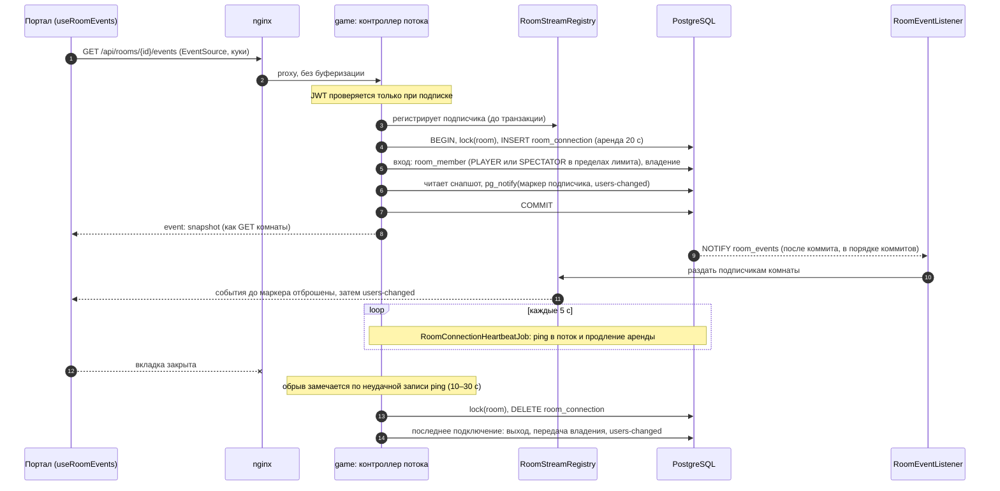

# C4 · Dynamic — поток комнаты и присутствие

Решения: [room-presence](../../game/room-presence.md), [realtime-transport](../../game/realtime-transport.md), [room-lifecycle](../../game/room-lifecycle.md). Таблицы — [erd/game](../../erd/game.md).

## События потока комнаты

| Событие | Данные | Реакция фронта |
|---|---|---|
| `snapshot` | комната целиком | заменить кеш `GET /api/rooms/{id}` |
| `users-changed` | `ownerId` + полный список участников | заменить поля |
| `settings-changed` | настройки | заменить поле |
| `session-changed` | — (старт, конец, отмена партии) | перечитать комнату |
| `room-deleted` | — | закрыть поток, перечитать (покажется `ROOM_NOT_FOUND`) |

- У событий комнаты нет seq: каждое несёт полное значение, повтор безопасен. Гонку снапшота с событиями закрывает маркер подписчика.
- Подключений у пользователя может быть несколько (вкладки, устройства), выход наступает с закрытием последнего.
- Процесс упал или не смог удалить подключение — `RoomConnectionCleanupJob` удалит его по истечении аренды. Поток, чьё подключение исчезло, закрывается, и клиент входит заново.
- Обрыв соединения LISTEN: `RoomEventListener` переподключается и закрывает все потоки. Клиенты переподключаются и получают свежий снапшот.
- Нет мест: новичку не досталось места игрока, а наблюдателей уже не меньше `settings.room.maxSpectators` — вход откатывается, поток отвечает 409 `NO_SPECTATOR_SEAT`. `EventSource` кода не видит, поэтому портал перечитывает комнату. Если пользователь не участник и мест нет, показывается окончательный отказ без переподключения.
