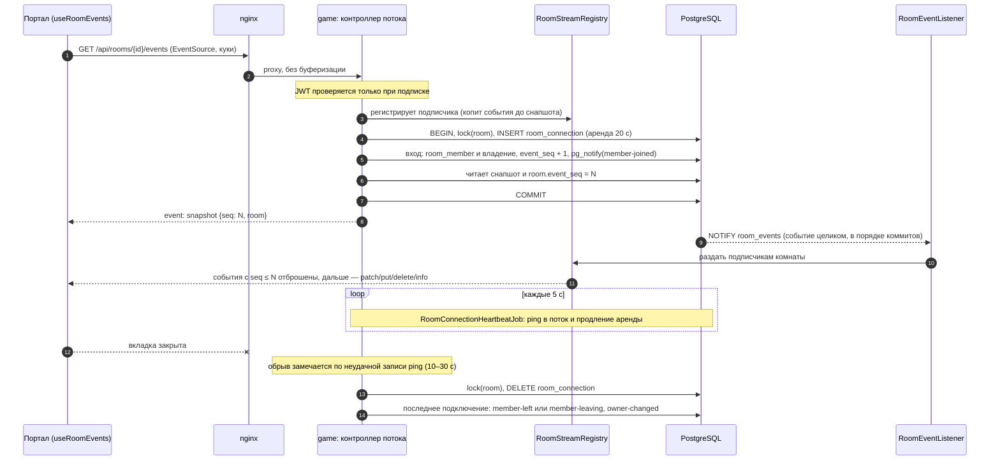

# C4 · Dynamic — поток комнаты и присутствие

Решения: [room-presence](../../game/room-presence.md), [realtime-transport](../../game/realtime-transport.md), [room-lifecycle](../../game/room-lifecycle.md), [session-events-format](../../game/session-events-format.md). Таблицы — [erd/game](../../erd/game.md).

## События потока комнаты

Документ потока — комната в форме `RoomResponse`. Первое сообщение — `snapshot {seq, room}`, дальше события-патчи `{seq, at, method, code, data}` (SSE-имя — метод в нижнем регистре), как у партии. Фронт применяет их общим `applyPatch` строго по seq.

| code | Операция | Когда |
|---|---|---|
| `member-joined` | `PUT [members, {id}]` участник | новый участник |
| `member-left` | `DELETE [members, {id}]` | ушёл; отсутствующий игрок после конца партии |
| `member-leaving` / `member-returned` | `PATCH [members, {id}] {leaving}` | игрок идущей партии отключился / вернулся |
| `member-kicked` | `INFO {userId}` | владелец исключил участника; следом `member-left` или `member-leaving` |
| `role-changed` | `PATCH [members, {id}] {role}` | смена роли |
| `profile-changed` | `PATCH [members, {id}] {nickname, avatar}` | смена профиля в user-auth |
| `owner-changed` | `PATCH [] {ownerId}` | новый владелец (null — присутствующих нет) |
| `settings-changed` | `PUT [settings]` | настройки целиком |
| `session-started` / `session-ended` | `PATCH [] {status, session}` | старт; конец или отмена партии |
| `room-deleted` | `INFO` | комната удалена, последнее событие, поток закрывается |

- Одно событие — одна операция: уход владельца — `member-left` + `owner-changed`, конец партии — `session-ended` + `member-left` на каждого отсутствующего, кик — `member-kicked` + `member-left` (или `member-leaving`).
- Кик (`DELETE /api/rooms/{id}/members/{userId}`, только владелец): подключения исключённого удаляются в той же транзакции. Для его подписчиков `member-kicked` последнее (`RoomEventResponseMapper.isLast`), диспетчер закрывает их потоки и потоки партий. Портал уводит исключённого на страницу игры с окном «Вас исключили».
- seq — `room.event_seq`, растёт в транзакции изменения под блокировкой комнаты. Данные события фиксируются там же и идут в payload NOTIFY (лимит 8000 байт проверяет `RoomEventPublisher`), диспетчер в БД не ходит. `UserProfileListener` берёт блокировку каждой комнаты в своей транзакции.
- Мутации комнаты (роль, владение, старт, настройки) отвечают 204: изменение приходит событием. `GET` комнаты на странице нужен только для ошибок.
- Дыра в seq или неприменимый патч — фронт переоткрывает поток за свежим снапшотом. Переоткрытие — выход и вход: в заполненной комнате участник может вернуться наблюдателем. Дыра — признак бага: NOTIFY упорядочен, а обрыв LISTEN и так закрывает потоки.
- Подключений у пользователя может быть несколько (вкладки, устройства), выход наступает с закрытием последнего.
- Процесс упал или не смог удалить подключение — `RoomConnectionCleanupJob` удалит его по истечении аренды. Поток, чьё подключение исчезло, закрывается, и клиент входит заново.
- Обрыв соединения LISTEN: `RoomEventListener` переподключается и закрывает все потоки. Клиенты переподключаются и получают свежий снапшот.
- Нет мест: новичку не досталось места игрока, а наблюдателей уже не меньше `settings.room.maxSpectators` — вход откатывается, поток отвечает 409 `NO_SPECTATOR_SEAT`. `EventSource` кода не видит, поэтому портал перечитывает `GET` комнаты. Если пользователь не участник и мест нет, показывается окончательный отказ без переподключения.
