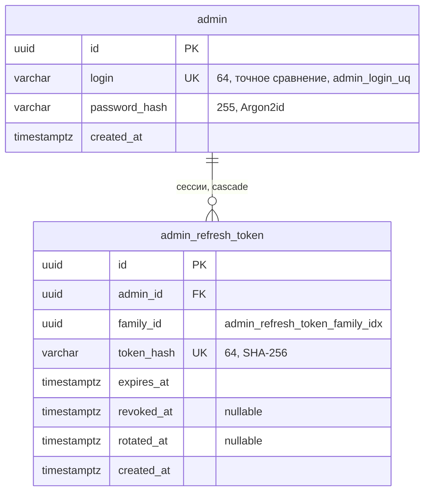

# ERD · admin-auth

Источник правды — `backend/admin-auth/admin-auth/src/main/resources/db/changelog/admin-auth/DDL/`. Решения: [admin-separation](../security/admin-separation.md), [jwt-and-refresh](../security/jwt-and-refresh.md).

| Таблица | Назначение | Ограничения |
|---|---|---|
| `admin` | Администратор. Ролей нет, первого админа создаёт бутстрап, если таблица пуста | `admin_login_uq` |
| `admin_refresh_token` | Refresh-токены админки, устроены как у игроков | `admin_refresh_token_hash_uq` |

Имена таблиц уникальны в приложении, поэтому `admin_refresh_token`, а не `refresh_token` ([migrations](../backend/migrations.md)).
