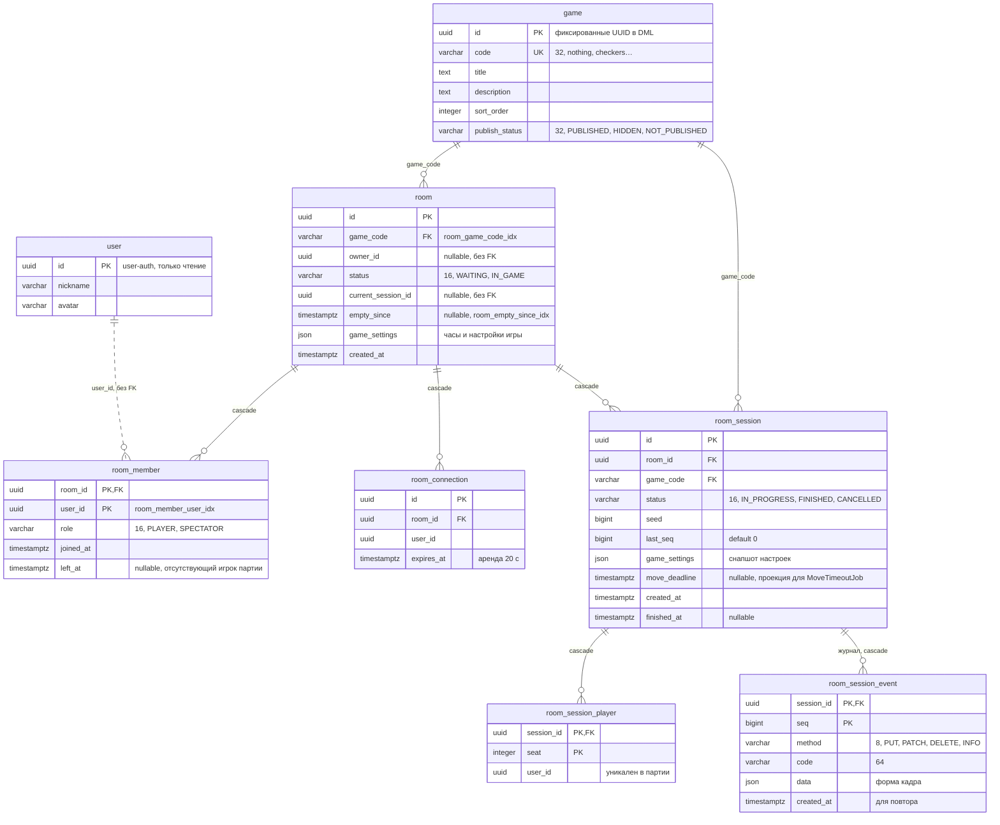

# ERD · game

Источник правды — `backend/game/game/src/main/resources/db/changelog/game/DDL/`. Решения: [game-catalog](../game/game-catalog.md), [room-lifecycle](../game/room-lifecycle.md), [room-presence](../game/room-presence.md), [session-state](../game/session-state.md).

| Таблица | Назначение |
|---|---|
| `game` | Каталог игр, строки вставляются DML-миграциями |
| `room` | Комната под игру. Блокировка строки (`FOR UPDATE`) сериализует все её мутации |
| `room_member` | Участники и их роли |
| `room_connection` | Присутствие: одно открытое SSE-подключение — одна строка с арендой |
| `room_session` | Партия. Состояние не хранится, только `last_seq` и проекция дедлайна |
| `room_session_player` | Места игроков партии (`room_session_player_user_uq (session_id, user_id)`) |
| `room_session_event` | Журнал событий-патчей, только дописывается. Состояние — его свёртка |
| `user` | Таблица user-auth, читается через `UserProfileTable` (join за ником и аватаром) |

**Индексы:** `room_session_room_idx (room_id, created_at)`, `room_session_move_deadline_idx`, `room_connection_room_user_idx`, `room_connection_expires_at_idx`. FK на `user` нет намеренно: модуль пишет только в свои таблицы, связь с чужой таблицей существует только в коде ([module-communication](../backend/module-communication.md)).
