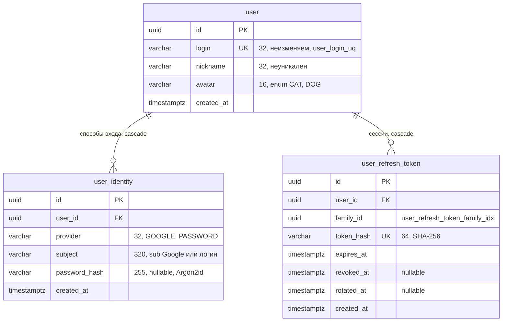

# ERD · user-auth

Источник правды — `backend/user-auth/user-auth/src/main/resources/db/changelog/user-auth/DDL/`. Решения: [player-accounts](../security/player-accounts.md), [jwt-and-refresh](../security/jwt-and-refresh.md), [data-access](../backend/data-access.md).

| Таблица | Назначение | Ограничения |
|---|---|---|
| `user` | Аккаунт игрока | `user_login_uq` |
| `user_identity` | Способ входа. К аккаунту можно привязать несколько, но не больше одного на провайдера | `user_identity_provider_subject_uq (provider, subject)`, `user_identity_user_provider_uq (user_id, provider)` |
| `user_refresh_token` | Refresh-токены с ротацией по семье (`family_id`) | `user_refresh_token_hash_uq` |

**Чтение другими модулями:** `UserProfileTable` в `user-auth-api` — публичное описание колонок `id`, `nickname`, `avatar` таблицы `user`. Модуль game делает по нему join (только чтение), см. [erd/game](game.md).
